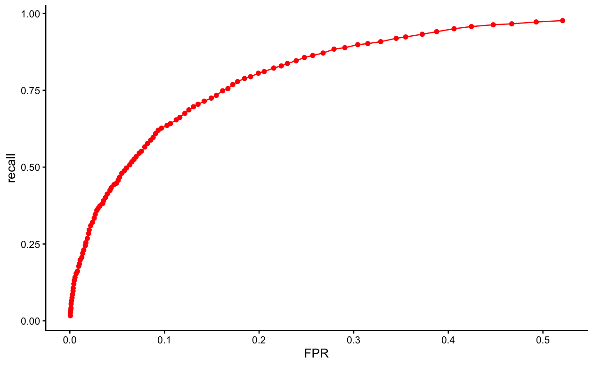
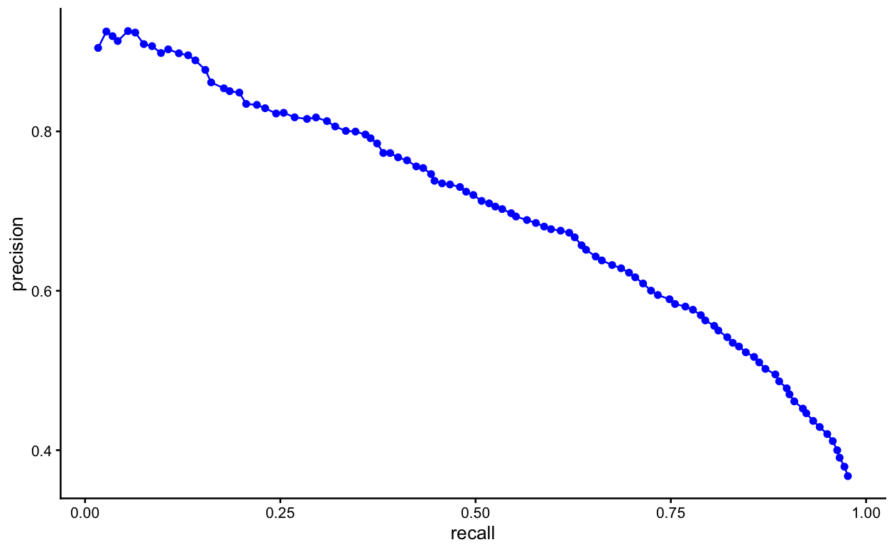

# m6APrediction

An R package for predicting **N6-methyladenosine (m6A) RNA modification sites** using random forest machine learning models. It takes RNA site features (GC content, RNA type, region, exon length, distance to junction, evolutionary conservation and the DNA 5-mer sequence) and outputs predicted m6A probabilities and Positive/Negative status labels.

## Installation

Install the development version from GitHub with:

```r
# install.packages("remotes")
remotes::install_github("xgjq64htgr-beep/m6APrediction")
```

Or with devtools:

```r
# install.packages("devtools")
devtools::install_github("xgjq64htgr-beep/m6APrediction")
```

## Usage

Load the package and the pre-trained random forest model shipped with it:

```r
library(m6APrediction)

ml_fit &lt;- readRDS(system.file("extdata", "rf_fit.rds",
                              package = "m6APrediction", mustWork = TRUE))
```

### Single-sample prediction

Predict the m6A probability of one RNA site:

```r
prediction_single(ml_fit, gc_content = 0.6, RNA_type = "mRNA",
                  RNA_region = "CDS", exon_length = 12,
                  distance_to_junction = 5,
                  evolutionary_conservation = 0.8, DNA_5mer = "GGACA",
                  positive_threshold = 0.5)
```

### Multiple-sample prediction

Predict m6A probabilities for a data frame of RNA sites:

```r
example_df &lt;- read.csv(system.file("extdata", "m6A_input_example.csv",
                                   package = "m6APrediction", mustWork = TRUE))
result &lt;- prediction_multiple(ml_fit, example_df[1:3, ], positive_threshold = 0.6)
result
```

The DNA 5-mer sequences are encoded internally into nucleotide-position factors before prediction.

## Model Performance

The random forest model achieves strong performance on held-out test data:




## License

MIT
